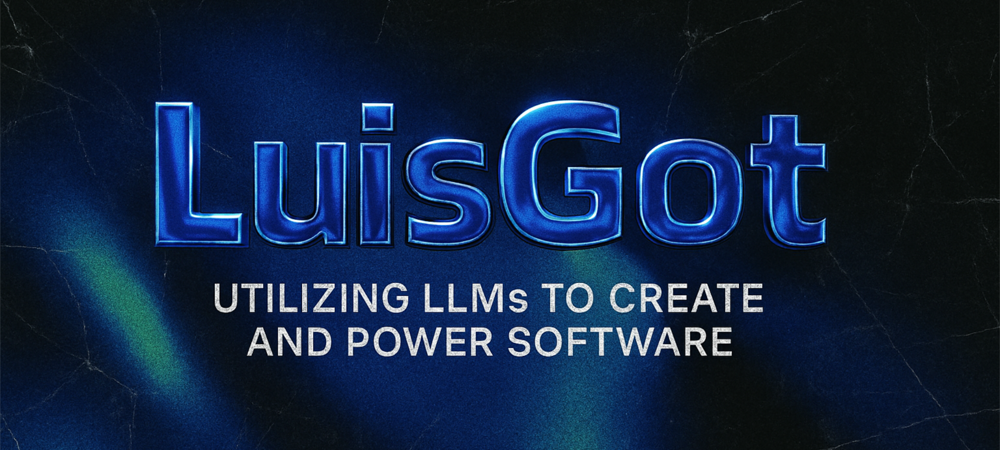

Ich bin Luis, Software Engineer und Gründer von Nyxos AI. Ich baue KI-Lösungen, die Menschen gerne nutzen: technisch sauber umgesetzt und so gestaltet, dass sie sich im Alltag gut anfühlen. KI setze ich nur dort ein, wo sie echten Nutzen bringt.

[nyxos-ai.com](https://nyxos-ai.com) · [LinkedIn](https://www.linkedin.com/in/luis-g%C3%B6ttler-015b9a312/)
